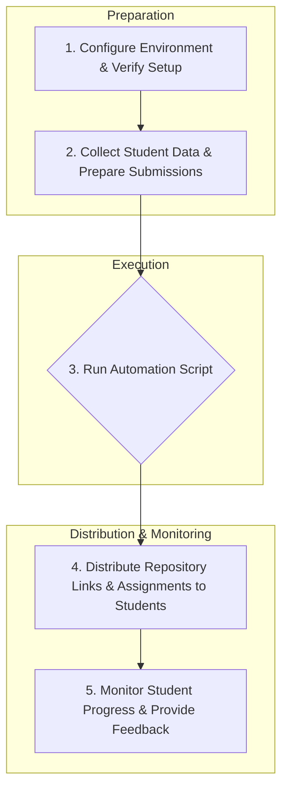
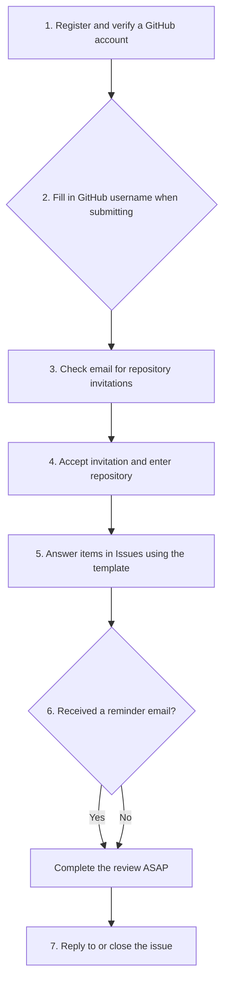

GitHub Code Peer Review Automation

================

This R package provides a suite of tools to automate the setup and management of code peer review assignments using GitHub.
It's designed to integrate with existing workflows, such as using Moodle for submissions, while leveraging the collaborative power of GitHub.

Code peer review detailed guidance webbook is [here](https://github.com/stats-ucl/code-review-book/tree/master).

## Key Features

The system allows you to:

- **Automated Repository Creation**: Automatically create private GitHub repositories for each student.

- **Submission Management**: Easily upload student code submissions from local folders to their dedicated repositories.

- **Randomized Peer Review Assignment**: Randomly assign peer reviewers to each student.

- **Structured Feedback**: Set up repositories with structured peer review templates using GitHub Issues.

- **Progress Monitoring**: Track the progress of peer reviews and send automated reminders.

- **Email Notifications**: Generate email templates to distribute repository information and review assignments to students.

## Setup

### GitHub Setup

1. **GitHub Organization**: Create or have access to a GitHub organization
2. **Personal Access Token**: Create a token with these permissions:
   - `repo` (full control of private repositories)
   - `admin:org` (full control of organizations and teams)
   - `user` (update user data)

### Data Requirements

1. **Student List**: CSV file with student IDs, GitHub usernames, emails, and names
2. **Submission Files**: Student code files organized in folders by student ID. These can be downloaded from Moodle submissions.

## Quick Start

### 1. Installation

You can install the package and its dependencies from your R console:

```r
# Install the devtools package if you don't have it
if (!requireNamespace("devtools", quietly = TRUE)) {
    install.packages("devtools")
}

# Install the package from GitHub
devtools::install_github("https://github.com/stats-ucl/code-peer-review")
```

### 2. Initial Setup

The `run_setup()` function will guide you through the initial configuration process.
This includes setting up your GitHub authentication, creating the necessary directory structure, and generating sample configuration files.

```r
# Load the package
library(codeinput)

# Run the setup script
run_setup()
```

### 3. Prepare Your Data

**Student List (`student_list.csv`):** Create a CSV file with the following columns: student_id, github_username, ucl_email, and name.

```csv
student_id,github_username,ucl_email,name
12345,alice_github,alice@ucl.ac.uk,Alice Smith
12346,bob_github,bob@ucl.ac.uk,Bob Jones
```

**Submission Files:**
Organize each student's submitted files in `submissions/[student_id]/` folders:

```
submissions/
├── 12345/
│   ├── analysis.R
│   └── report.Rmd
├── 12346/
│   ├── analysis.R
│   └── data_cleaning.R
```

### 4. Run Main Automation

Run `run_automation()` directly (or via the generated `main_automation_script.R` starter script):

```r
library(codeinput)

results <- run_automation(
  org_name = "UCL-StatSci-STAT0001-2025",
  assignment_name = "assignment-1",
  submissions_path = "submissions",
  output_dir = "output",
  reviews_per_student = 2,
  deadline = "2025-04-15",
  instructor_name = "Course Instructor"
)
```

### 5. Monitor Progress

You can monitor the progress of peer reviews using `run_progress_check()` (or via `monitor_progress_script.R`):

```r
library(codeinput)

report <- run_progress_check(
  org_name = "UCL-StatSci-STAT0001-2025",
  assignment_name = "assignment-1",
  output_dir = "output",
  deadline = "2025-04-15",
  instructor_name = "Course Instructor"
)
```

## Configuration

### GitHub Authentication
Set up your GitHub token using `usethis` and `gitcreds` (recommended) or `.Renviron`:

**Option 1: `gitcreds` credential store (recommended)**
```r
usethis::create_github_token(scopes = c("repo", "admin:org", "user"))
gitcreds::gitcreds_set()
```

**Option 2: Project `.Renviron` file**
```r
usethis::edit_r_environ(scope = "project")
# Add: GITHUB_TOKEN=your_token_here
```

### Workflow Parameters
Configure these parameters when calling `run_automation()` or editing `main_automation_script.R`:
```r
ORG_NAME <- "UCL-StatSci-STAT0001-2025"      # Your GitHub organization
ASSIGNMENT_NAME <- "assignment-1"            # Assignment identifier
SUBMISSIONS_PATH <- "submissions"            # Path to submission folders
OUTPUT_DIR <- "output"                       # Directory for generated files
```

## Workflow

### For Teachers



1. Setup (one-time): Run `codeinput::run_setup()` to configure your environment.

2. Prepare data:
   - Create the `student_list.csv` file.
   - Download student submissions and organize them into the `submissions/` folder.

3. Run automation: Execute the `main_automation_script.R` script.

4. Distribute access: Send the generated emails to students.

5. Monitor progress: Use the `monitor_progress_script.R` to track progress and send reminders.

### For Students



Students will receive an email containing:

- A link to their personal, private GitHub repository.

- Instructions for accessing their peer review assignments.

- Links to the repositories of the students they need to review.

- Email notifications when they receive feedback.

## Output Files

All generated files for distribution and monitoring are saved in the `output/` directory:

- `output/student_repo_links.csv` - Repository URLs for each student
- `output/reviewer_assignments.csv` - Balanced assignment matrix (who reviews whom)
- `output/teacher_summary.csv` - Complete overview for instructors
- `output/email_templates/` - Individual email files for each student and `email_merge_data.csv`
- `output/progress_check_[date].csv` - Repository-level progress monitoring data
- `output/student_progress_[date].csv` - Student-level completion summary
- `output/reviewer_progress_[date].csv` - Reviewer-level completion summary
- `output/progress_reports/` - Visualization plots (`completion_distribution.png`, `issues_vs_pulls.png`)
- `output/reminders/` - Targeted reminder emails for reviewers with pending reviews


## Troubleshooting

See a list of common issues [here](md/troubleshooting.md).
If you come across something not included here, please raise an [Issue](https://github.com/stats-ucl/code-peer-review/issues).
